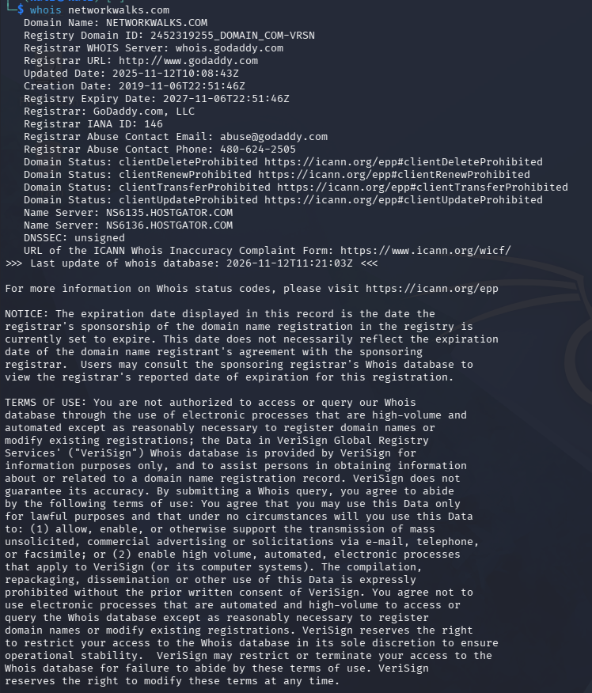
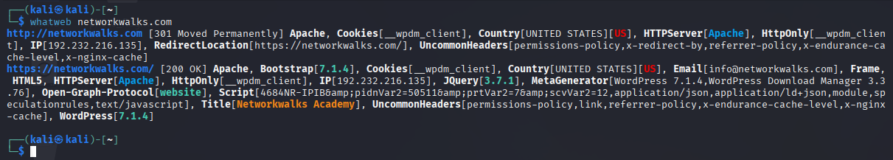
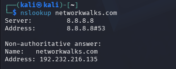
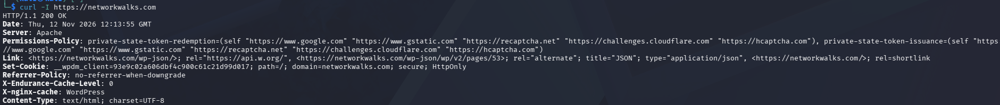
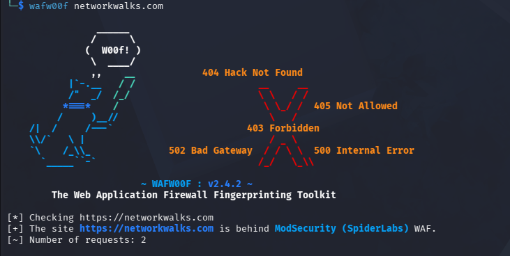
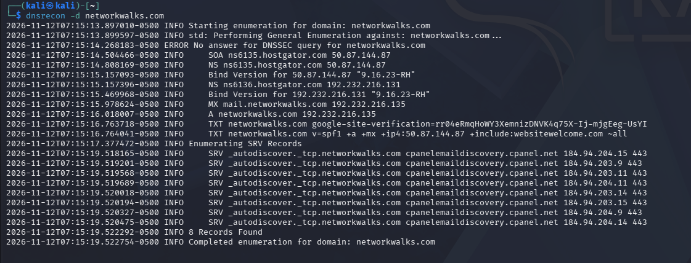
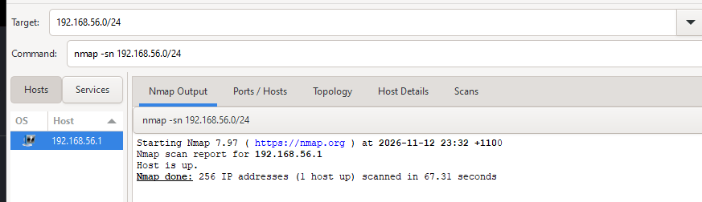

  
# NETWORKWALKS-B084-WEEK2-PM1-2-5
This project involves conducting reconnaissance on an authorized domain in a controlled environment. 

# 1. Liability Disclaimer

This report was prepared as part of the NetworkWalks Cybersecurity Internship Program (B084) for educational purposes. Written authorisation was obtained prior to conducting the security assessments.
All activities were performed within the authorised scope, focusing on footprinting, reconnaissance, and network scanning. No attempts were made to exploit vulnerabilities, disrupt services, or gain unauthorised access.
The findings are intended solely for educational and security awareness purposes and should not be interpreted as confirmed vulnerabilities unless supported by evidence.

# 2. Introduction

This report documents the activities completed during Week 2 of the NetworkWalks Cybersecurity Internship Program (B084). The exercises focused on footprinting and reconnaissance, alongside network scanning using Zenmap (W2-PM5).

The first activity involved gathering publicly available information about the networkwalks.com domain using various Kali Linux tools. This included WHOIS lookups, DNS enumeration, HTTP header analysis, and Web Application Firewall (WAF) detection. Google Dorking was also performed to identify publicly indexed resources, including potentially exposed IP cameras and mathematics textbook directories.

The second activity focused on identifying active devices within my local network using Zenmap on Windows. This involved performing ping scans to discover live hosts and examining their IP and available MAC addresses.

The purpose of these exercises was to develop practical skills in information gathering, network discovery, and understanding potential security risks. Each activity is supported by relevant commands, observations, screenshots, and explanations of the findings.

# 3. Tools Used

The table below lists each tool used in this report and each of their respective purpose.

| Tool | Purpose |
|---|---|
| Kali Linux / Windows | Operating systems used for reconnaissance activities           |
| WHOIS                | Find any domain registration details (owner, dates, name servers).   |
| whatweb              | Fingerprint any web technologies         |
| nslookup             | Resolve the domain name to its IP address using DNS.             |
| curl -I              | Read the HTTP response headers of the website.                   |
| wafw00f              | Detects any Web Application Firewall protecting a site or domain.     |
| dnsrecon             | Enumerate all DNS records (NS, MX, SPF, TXT, SRV).               |
| Zenmap (Nmap GUI)    | Scans the local subnet to find live hosts, IPs and MAC addresses. |
| Windows CMD          | Local IP and MAC address identification                          |

# 4. Activities Performed

## 4.1 Footprinting & Reconnaissance

I performed reconnaissance on the networkwalks.com domain using six Kali Linux tools: WHOIS, WhatWeb, Nslookup, Curl, Wafw00f, and DNSRecon. Each tool was used to gather publicly available information about the domain and its infrastructure.

WHOIS identified the domain's registrar, registration dates, and name servers, while WhatWeb revealed website technologies including WordPress, Apache, Bootstrap, and jQuery. Nslookup resolved the domain to 192.232.216.135, and Curl retrieved HTTP headers, including the WordPress REST API endpoint /wp-json/.

Wafw00f identified ModSecurity (SpiderLabs) as the website's Web Application Firewall, while DNSRecon revealed several DNS records, including A, NS, MX, TXT/SPF, and SRV records.

These findings demonstrate how publicly available information can reveal details about a website's technologies, infrastructure, and security configuration.

## 4.2 Footprinting with Google Dorking
I performed Google Dorking using advanced search operators such as intitle: and inurl: to identify publicly indexed resources. The investigation focused on two categories: potentially exposed IP cameras and mathematics textbook directories.

Potentially Exposed IP Cameras
| No | Link | Relevant Dork |
|---|---|-------------------|
|1|[DATA REDACTED]|"Camera Live Image" inurl:"guestimage.html"|
|2|[DATA REDACTED]|intitle:”Live View / - AXIS|
|3|[DATA REDACTED]/|inurl:view/view.shtml|
|4|[DATA REDACTED]|intitle:”Live View / - AXIS 206M”|
|5|[DATA REDACTED]|inurl:indexFrame.shtml Axis|
|6|[DATA REDACTED]|inurl:indexFrame.shtml Axis|
|7|[DATA REDACTED]|intitle:Axis 2400 video server|
|8|[DATA REDACTED]|intitle:"Live View / — AXIS" | inurl:view/view.shtml|
|9|[DATA REDACTED]|inurl:ViewerFrame?Mode=Refresh|
|10|[DATA REDACTED]|intitle:"NoVus IP camera" -com|

Mathematics Textbook Directories
| No | Link | Relevant Dork |
|---|---|-------------------|
|1|https://education.giakonda.org.uk/Maths/|intitle:"Index of /maths"|
|2|https://hub.melroseps.vic.edu.au/Maths/|intitle:"Index of /maths"|
|3|http://meteck.org/files/|intitle:"Index of /maths"|
|4|http://erewhon.superkuh.com/library/Math/|index of : "mathematics"|
|5|https://theswissbay.ch/pdf/Books/Mathematics/|inurl: intitle:"Mathematics"|
|6|https://theswissbay.ch/pdf/Gentoomen%20Library/Maths/|inurl: intitle:"Maths"|
|7|https://lira.epac.to/DOCS-TECH/Math/Engineering%20and%20Applied/|intitle:index.of "mathematics.pdf"|
|8|https://petermc.net/maths/olympiad/|inurl: intitle:"Maths"|
|9|http://library.cusat.ac.in/cat/2013/|inurl: intitle:"Maths"|
|10|https://www.williamle.com/staticstuff/Textbooks/	|inurl: intitle:"Maths"|

These results highlight how publicly accessible documents and directories can be located using search engines. While some resources may be intentionally public, others could reveal information that was not intended for public access.

Note: Direct URLs to potentially exposed IP camera interfaces have been redacted to prevent the unnecessary disclosure of potentially private resources. 

## 4.3 Network Scanning with Zenmap

I used Zenmap on Windows to perform network discovery and identify active devices within my local network. The activity involved identifying network configurations, performing ping scans, and recording available IP and MAC addresses.

I first used the ipconfig command to identify my network interfaces. My home LAN address was 192.168.0.147, belonging to the 192.168.0.0/24 subnet. I also identified separate virtual networks associated with VirtualBox and VMware.

Ping Scan & Host Discovery

I performed a ping scan against the VirtualBox host-only network using:
nmap -sn 192.168.56.0/24

The scan covered 256 IP addresses and identified one active host (192.168.56.1), corresponding to my Windows ethernet adapter. The adapter's MAC address was recorded as 0A-00-27-00-00-3C.

I also scanned my home LAN (192.168.0.0/24), which identified multiple household devices, including smartphones and a PlayStation 5.

Network Topology

Following the scan, I used Zenmap's Topology feature to visualise the VirtualBox host-only network and exported the results as a PDF.

The topology displayed localhost and 192.168.56.1, consistent with the scan results.

Overall, this activity demonstrated how network scanning can identify active hosts, reveal network addressing information, and distinguish between physical and virtual network environments.

# 5. Risk Analysis / Impact

The reconnaissance and network scanning activities identified several potential security risks relating to information disclosure, publicly accessible resources, and network architecture visibility.

| Finding | Potential Impact | Risk Level | Evidence |
|---|---|-------------------|-----------------|
|Website Technology Disclosure| Identified technologies such as WordPress and Apache could help attackers research known vulnerabilities affecting specific software versions.| Low | WhatWeb scan and Curl HTTP headers |
|DNS & Domain Information | Publicly available DNS records reveal hosting, name server, and email infrastructure information that could assist attackers with learning about the domain | Low | WHOIS, Nslookup, and DNSRecon screenshots|
|Public IP Cameras | Publicly indexed camera interfaces could create privacy risks if authentication and access controls are misconfigured. | High | Google Dorking results |
|WAF Detection | ModSecurity was detected, indicating an additional security measure rather than a confirmed vulnerability. | Low | Wafw00f scan screenshot |
| Publicly Indexed Documents | Unintentionally exposed directories could reveal sensitive documents or information. | Medium | Google Dorking Results |
|Network Host Discovery | Identifying live devices and their IP addresses could help attackers map a network and locate potential targets | Medium | Zenmap Ping Scan and topology PDF |

# 6. Recommendations

Based on the findings, the following recommendations could help reduce unnecessary information exposure and strengthen overall security posture.
| Area | Recommendations |
|---|----------------------|
|Website Security|Regularly update WordPress, plugins, and server software to minimise known security vulnerabilities.|
|Information Disclosure|Review publicly exposed information and limit unnecessary disclosure of software versions and configurations.|
|DNS Security|Review DNS records regularly, remove outdated entries, and consider implementing DNSSEC (Domain Name System Security Extensions) when relevant.|
|IP Camera Security|Enforce strong authentication, restrict public access, and limit camera interfaces to trusted networks.|
|Document Exposure|Apply access controls to sensitive directories and review publicly indexed documents.|
|Network Security|Maintain an inventory of connected devices, update firmware, and remove untrusted devices from critical systems|
|WAF Management |Regularly update and review WAF rules to maintain protection against web-based threats.|

These recommendations address potential risks identified during reconnaissance and network discovery. They are preventive measures rather than responses to confirmed vulnerabilities.

# 7. Conclusion/Lessons Learned

During Week 2 of the NetworkWalks Cybersecurity Internship Program (B084), I completed practical activities focusing on footprinting, reconnaissance, Google Dorking, and network scanning.

The first activity involved using six Kali Linux tools to gather publicly available information about the networkwalks.com domain. Through these tools, I learned how domain registration details, website technologies, DNS records, HTTP headers, and security mechanisms can be identified and analysed. These findings demonstrated how publicly available information can provide insight into a website's infrastructure and configuration.

The Google Dorking activity involved using advanced search operators to identify publicly indexed resources, including potentially exposed IP camera interfaces and mathematics textbook directories. I recorded 20 results across both categories, which demonstrated how search engines can reveal publicly accessible information that may have security implications.

The network scanning activity involved using Zenmap to identify active hosts within my local network. I learned how to identify network subnets, perform ping scans, record IP and MAC addresses, and generate a network topology. This also improved my understanding of the differences between physical and virtual networks.

Overall, these activities strengthened my understanding of how information gathering and network discovery support cybersecurity assessments. I also learned the importance of documenting findings clearly, identifying potential risks, and providing appropriate security recommendations. All activities were conducted within the authorised scope of the internship, reinforcing the importance of ethical and responsible security testing.

# 8. Evidence Collected

## 9. Challenges

Challenge 1: Kali Linux Network Connectivity

My VirtualBox Kali Linux VM initially experienced connectivity issues due to a suspected conflict involving its manually configured IP address (10.0.0.2). This prevented successful DNS resolution and interrupted several reconnaissance commands.

To resolve this, I switched the network configuration to DHCP, which automatically assigned 10.0.0.3 and restored internet connectivity.

## Author Information
Ali Fares

Cybersecurity Intern | Networkwalks B084

https://www.linkedin.com/in/ali-fares-86870733a/
## Project Information
Program Name: Cybersecurity at Networkwalks | Week: 02 | Project: Domain Fingerprinting & Reconnaissance
